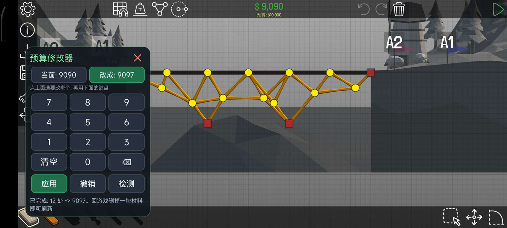
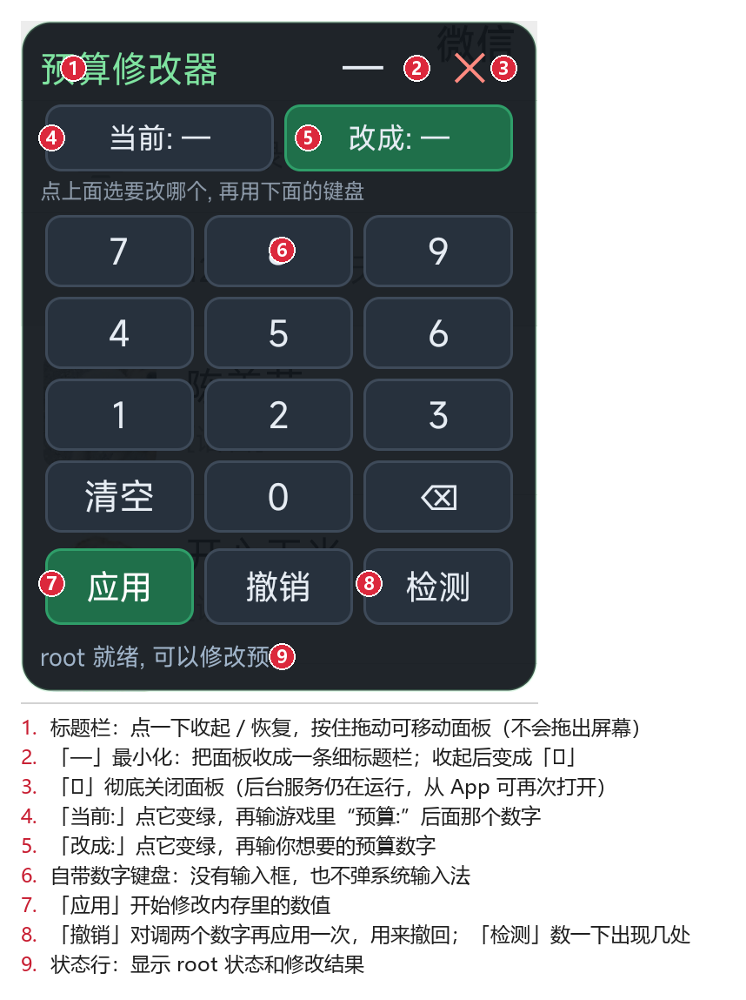
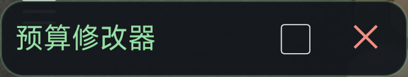

# Poly Bridge 预算修改器

> 一个给 **Poly Bridge** 用的 Android 悬浮面板：**进游戏 → 点面板 → 改预算 → 完事**。
> 不用电脑、不用改存档、不暂停游戏，随改随用。



<p align="center">
  
  &nbsp;&nbsp;➜&nbsp;&nbsp;
  
</p>

---

## 这是什么

Poly Bridge 每一关的预算是写死的，桥造到一半钱不够就很难受。这个小工具做的事只有一件：

**把当前关卡正在使用的预算额度，改成你想要的任何数字。**

它靠 root 权限直接修改游戏**运行内存**里那个预算数值，所以：

| 做得到 | 做不到（故意的） |
| --- | --- |
| 把当前关卡预算改成任意数字 | ❌ 不解锁关卡 |
| 想改几次改几次，改错了还能撤回 | ❌ 不修改存档文件 |
| 只影响当前这一关，别的关不动 | ❌ 不做永久修改（退出游戏就复原） |
| 面板可最小化，不挡视线 | ❌ 不联网、不上传任何数据 |

> 只改预算，**不解锁关卡** —— 这是刻意保持的设计，让游戏该有的挑战还在。

---

## 效果

游戏画面顶部有两个数字，**上面绿色的是「已经花掉的钱」，下面那行 `预算:` 才是预算**。
这个小工具改的是下面那个：

```text
修改前                         修改后
$ 9,090                        $ 2,306
预算: $10,000        ➜         预算: $999,999
```

改完之后，三千块的桥也能照一万块的思路随便造。

---

## 快速开始

### 0. 前提条件

- 手机**必须已 root**（Magisk，实测 Magisk 28.1 通过）
- Android **8.0 及以上**（已在 Android 13 / MIUI 上实测）
- 需要「**显示在其他应用上层 / 悬浮窗**」权限

### 1. 安装

下载 [`app/budget-mod.apk`](app/budget-mod.apk)，传到手机上安装（允许「未知来源」）。
装好后打开一次，按提示授予**悬浮窗权限**。

> ⚠️ 如果你**重新安装**过这个 App，系统会把悬浮窗权限重置掉，需要再去设置里给一次。
> 直接在 App 里点「打开悬浮面板」，它会自动跳到授权页面。

### 2. 打开游戏并进入关卡

一定要**进到关卡里面**，让屏幕上方出现 `预算: $xxxx` 那一行。

### 3. 打开面板改数字

在「预算修改器」App 里点 **「打开悬浮面板」**，面板就会浮在游戏上面：



操作顺序：

1. 点 **「当前:」**（变绿）→ 用面板键盘输入游戏里 `预算:` 后面那个数字，例如 `10000`
2. 点 **「改成:」**（变绿）→ 输入你想要的预算，例如 `999999`
3. 点 **「应用」**，状态行会显示 `已完成: N 处 -> 999999`
4. **切回游戏，随便放一块或删掉一块材料** ← 这一步必须做，见下

### 4. 回游戏刷新

游戏**不会自己刷新**那行预算文字，它只在你**动一下桥**的时候才重画。
所以改完之后随便放一块或删一块材料，`预算:` 就会立刻变成新数字：


---

## 面板说明

| 位置 | 说明 |
| --- | --- |
| **标题栏** | 点一下 **收起 / 恢复** 面板；按住拖动可移动面板（拖动被限制在屏幕内，不会拖丢） |
| **「—」** | 最小化，把面板收成一条细标题栏，不挡游戏；收起后变成 **「▢」**，再点一下展开 |
| **「✕」** | 彻底关闭面板（后台服务还在，从 App 可以再次打开） |
| **「当前:」** | 游戏里现在是多少，就填多少 |
| **「改成:」** | 你想改成多少 |
| **数字键盘** | 面板自带，**没有输入框、也不弹系统输入法** |
| **「应用」** | 开始修改 |
| **「撤销」** | 把两个数字对调后再应用一次，用来撤回上一次修改 |
| **「检测」** | 数一下这个数字此刻在内存里出现了几次，应用前可以先核对 |
| **状态行** | 显示 root 状态和修改结果 |

最小化之后长这样，只有薄薄一条，完全不挡游戏：



---

## 它是怎么做到的

三句话版本：

1. 这个游戏是 Unity **Mono** 后端，用 `ildump` 反汇编 `Assembly-CSharp.dll` 就能读出每个方法的 IL，
   于是能确认预算存在哪几个字段里（`LevelParametersScript.budgetAvailable` 是权威来源）。
2. App 用 `su` 拿到 root，直接读写游戏进程的 `/proc/<pid>/mem`，把那几个字段的值改成你要的数字。
3. 游戏的预算 HUD 只在特定时机重画（没有任何定时器），**删掉一块材料**是最省事的触发点 ——
   这就是为什么第 4 步必须做。

想深入了解请看：

- **[技术原理.md](docs/技术原理.md)** —— 预算字段、HUD 刷新路径、跨进程内存读写、为什么必须 4 字节对齐
- **[开发过程.md](docs/开发过程.md)** —— 完整踩坑记录：坐标搞反、存档加密、TLS 对齐、MIUI 输入法、空指针……一个个怎么解决的
- **[逆向分析记录.md](docs/逆向分析记录.md)** —— 原始的 IL 反汇编与交叉引用分析笔记

---

## 原理速览（给技术人员）

```text
┌──────────────────┐   su    ┌───────────────────────────┐
│ 预算修改器 (APK)  │ ──────► │ /proc/<pid>/mem           │
│ 悬浮面板 + 键盘   │  pbmem  │ 扫描 10000 → 命中 N 处    │
└──────────────────┘         │ 逐个重新读取确认后写入    │
                             └───────────────────────────┘
                                        │
                     游戏下一次 UpdateBudgetUI() 时
                                        ▼
                              屏幕上的 预算: $999,999
```

- **扫描目标**：`com.drycactus.hq.polybridge`，`armeabi-v7a`（32 位进程）
- **补丁策略**：先扫描收集地址 → 逐个**重新读取确认值没变** → 只写这 4 个字节
- **只碰 4 字节对齐**的整数，避免未对齐窗口横跨两个字段把邻居写坏
- **跳过文件映射区域**，不会脏页缓存、不会破坏真实文件
- 数值 **≤ 0 会显示成 `Unlimited`**，所以补丁值必须 > 0

---

## 仓库结构

```text
.
├─ app/
│  └─ budget-mod.apk          ← 修改器安装包（已签名，可直接装）
├─ docs/
│  ├─ 使用方法.md              ← 图文教程（面向玩家）
│  ├─ 常见问题.md              ← 18 条 FAQ（现象 / 原因 / 怎么办）
│  ├─ 技术原理.md              ← 逆向原理
│  ├─ 开发过程.md              ← 开发踩坑记录
│  ├─ 游戏本体.md              ← 游戏版本信息 / 校验值 / 下载
│  └─ 逆向分析记录.md           ← 原始分析笔记
├─ images/                    ← 文档用图
└─ README.md
```

### 安装包信息

| 项目 | 值 |
| --- | --- |
| 文件 | `app/budget-mod.apk` |
| 大小 | 29,133 字节 |
| 包名 | `com.pbmod.budget` |
| 最低版本 | Android 8.0 (API 26) |
| 签名 | debug 自签名 |
| SHA-256 | `5317E661EC6BEACD615D6050113212EE5589DCA54C1121F4A86097DB6583D131` |

---

## 常见问题

**面板看不见？** 悬浮窗权限被重置了。去系统设置里给「预算修改器」开「显示在其他应用上层」，
再回 App 点一次「打开悬浮面板」。

**提示「没有找到 X (0 处)」？** 你多半填成了绿色那个「已经花掉的钱」。
要填的是它**下面** `预算:` 后面那个数字。

**提示「已完成」但游戏里没变？** 正常，你还没做**放/删一块材料**那一步。

**状态一直「准备中…」或提示「超时」？** Magisk 的授权弹窗没点允许，去 Magisk 里放行。

**重启游戏后又要重新改？** 是的，这是设计如此 —— 只改内存，不落盘。

👉 全部 18 条见 **[常见问题.md](docs/常见问题.md)**

---

## 免责声明

- 本工具仅供**单机游戏本地修改**、个人学习逆向工程使用。
- 它**不包含游戏本体**，也不会修改游戏安装包或存档文件。你需要自己拥有正版游戏。
- 本仓库**不分发 Poly Bridge 的游戏 APK**（受版权保护），只提供自制修改器和文档；
  适配的游戏版本、SHA-256 校验值和下载方式见 [`docs/游戏本体.md`](docs/游戏本体.md)。
- 请勿用于任何商业用途或在线排行榜作弊。

---

## 支持环境

| 项目 | 实测值 |
| --- | --- |
| 手机 | Redmi K40 (`M2012K10C` / `ares`) |
| 系统 | Android 13 (MIUI) |
| Root | Magisk 28.1 |
| 游戏 | Poly Bridge v1.2.3 (`com.drycactus.hq.polybridge`) |
| 游戏架构 | Unity Mono / `armeabi-v7a` |
