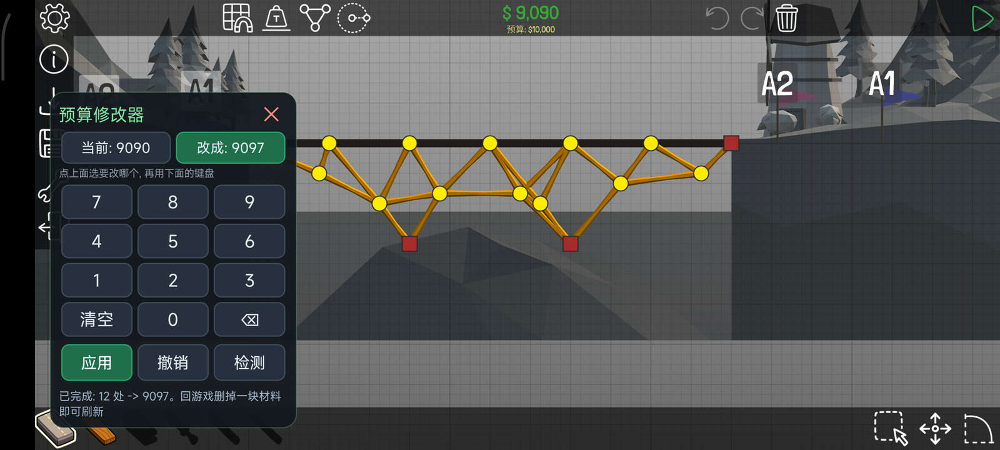
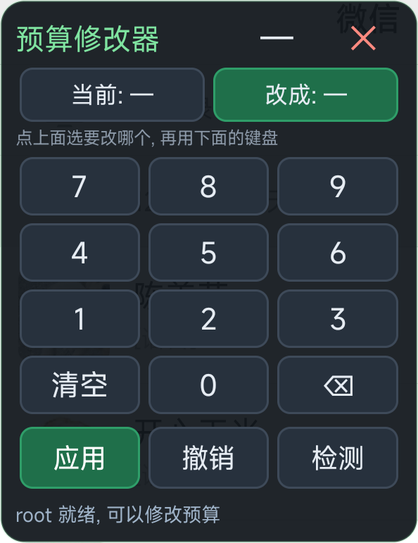
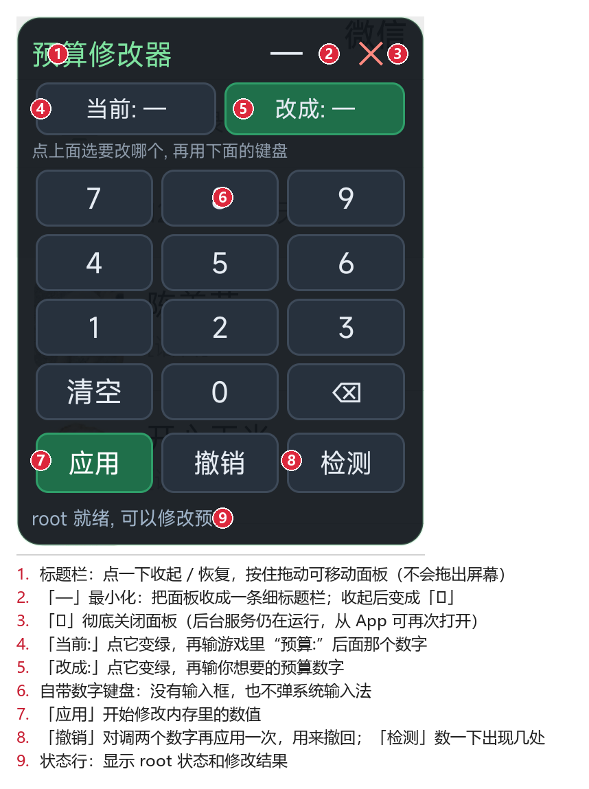
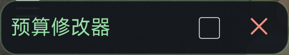

# 使用方法

> **一句话说明**：这个工具能给你正在玩的 Poly Bridge 关卡**改预算**——想改成多少就改成多少。
> 改完回到游戏，**放上一块或删掉一块材料**，屏幕上的预算数字立刻就变了。



---

## 一、它是干什么的

**预算修改器**是一个独立的小 App，用来修改游戏 **Poly Bridge**（桥梁工程师）里**当前这一关**的预算额度。

| 能做 | 不能做 |
| --- | --- |
| ✅ 把当前关卡的预算改成你想要的数字 | ❌ **不解锁关卡**（这是刻意不做的） |
| ✅ 想改几次改几次 | ❌ 不修改存档文件 |
| ✅ 完全免费、离线 | ❌ 不改金币、不解锁车辆 |
| ✅ 不用电脑，手机上就能用 | ❌ 不影响其他关卡 |

> **重点**：它只动**游戏的运行内存**，不动存档。
> 也就是说：**退出游戏就恢复原样**，下次进关卡要重新改一次。
> 这正是我们想要的效果——想用的时候随手改，不想用就退出游戏。

---

## 二、用之前要满足这些条件

1. **手机必须已经 root**（用 Magisk）。
   - 本次开发实测环境：**Magisk 28.1**。
   - 没有 root 用不了，这个工具靠 root 权限才能读写游戏的内存。
2. **Android 8.0 及以上**。
   - 实测通过：**Redmi K40（M2012K10C）、Android 13、MIUI**。
3. **给 App「显示在其他应用上层」权限**（也叫「悬浮窗」权限）。
   - 这是让面板能浮在游戏画面上的权限，**必须给**，否则面板看不见。
4. **MIUI 用户还要额外允许「后台弹出界面」**。
   - 在「设置 → 应用设置 → 预算修改器」里找，或者第一次点开会提示。

---

## 三、安装

1. 安装包就在仓库里：**`app/budget-mod.apk`**
2. 把它传到手机上（数据线、微信传文件、网盘都行），点开安装。
   - 安装时系统会提示「未知来源应用」，选择**允许**。
3. 装好后**先打开一次**这个 App。
   - 点一下 **「打开悬浮面板」**。如果还没给悬浮窗权限，App 会**自动跳到授权页面**，打开开关再回来重新点一次。

> ⚠️ **重新安装过的话要注意**
> 如果你用 `adb install -r` 之类的命令**覆盖安装**过，系统会把悬浮窗权限**重置掉**。
> 表现就是：面板怎么点都不出来。
> 解决办法：去**设置 → 应用管理 → 预算修改器 → 显示在其他应用上层**，重新打开一次即可。

---

## 四、改预算：完整步骤

### 第 1 步：先看清楚游戏上方的两个数字

先打开游戏，**进入一个关卡**，抬头看屏幕最上方：


- 上面那个**绿色的大数字**（例：`$ 9,090`）＝ **你已经花掉的钱**。**这个不用管。**
- 它**下面那一行**（例：`预算: $10,000`）＝ **本关的预算**。**我们要改的是这个。**

> 🔴 **这一步最容易搞错**：
> 要填的是 `预算:` **后面**那个数字，**不是**绿色的已花费金额。
> 填错了面板会提示「没有找到 … (0 处)」，白忙一场。

### 第 2 步：打开悬浮面板

1. 回到桌面，打开 **「预算修改器」** App。
2. 点 **「打开悬浮面板」**。
3. 第一次执行时，**Magisk 可能会弹出一个授权请求**，请点**允许**。
4. 面板出现后，看最下面的状态行：
   - 显示 **`root 就绪, 可以修改预算`** → 恭喜，可以用了 ✅
   - 显示别的 → 翻到 [常见问题](常见问题.md) 对照处理。

面板长这样：



### 第 3 步：填「当前」

1. 在面板上点一下 **「当前:」** 这个按钮，它会**变成绿色**（表示现在键盘输入的是这个框）。
2. 用面板自带的数字键盘，输入游戏里 `预算:` 后面那个数字。
   - 例：游戏显示 `预算: $10,000`，就输入 `10000`。
3. 输错了就按 **`⌫`** 退一格，或者按 **`清空`** 全部重来。

### 第 4 步：填「改成」

1. 点一下 **「改成:」** 按钮，它变绿。
2. 输入你想要的预算数字，比如 `999999`。

> 💡 数字**不能是 0，也不能是负数**（必须大于 0），否则面板会提示你重填。

### 第 5 步：点「应用」

1. 点绿色的 **「应用」** 按钮。
2. 等一下，看状态行出结果：
   - 正常会显示类似 **`已完成: 46 处 -> 999999。回游戏删掉一块材料即可刷新`**
   - 这表示内存已经改好了。**但此时游戏屏幕上还是旧数字，这是正常的！**

### 第 6 步（关键！）：回游戏，放一块或删一块材料

**这一步千万不能省。**

游戏只有在**你自己动一次手**（建造或删除材料）的时候，才会重画上面那行预算文字。

1. 切回游戏。
2. 随便**画一小段路**，或者**点选一块材料然后删掉**。
3. 抬头看——`预算:` 那一行立刻变成了新数字：


上图中，预算已经变成 **`预算: $999,999`** ✅
（上面那个 `$ 2,306` 是因为删了一块材料后重新算出来的已花费金额，会自己算对，不用管。）

**大功告成，现在你可以随便造了。**

---

## 五、面板上每个按钮都干什么



| 编号 | 名称 | 作用 |
| --- | --- | --- |
| ① | **标题栏** | **点一下**＝收起/恢复面板；**按住拖动**＝移动面板位置（拖动范围被限制在屏幕内，拖不丢） |
| ② | **「—」最小化** | 把面板收成一条很细的标题栏，不再挡住游戏；收起后它会变成 **「▢」**，意思是「点我恢复」 |
| ③ | **「✕」关闭** | **彻底关掉面板**（注意：跟「—」不一样，这是关闭） |
| ④ | **「当前:」** | 选中它，键盘输入的是**游戏现在显示的预算** |
| ⑤ | **「改成:」** | 选中它，键盘输入的是**你想要的预算**。④⑤ 被选中的那个会显示成绿色 |
| ⑥ | **键盘** | `7 8 9` / `4 5 6` / `1 2 3` / `清空 0 ⌫`。面板自带的，**不弹系统键盘**，不会打断游戏 |
| ⑦ | **应用 / 撤销 / 检测** | 见下方说明 |
| ⑧ | **状态行** | 显示结果和提示，出问题先看这里 |

### ⑦ 里三个按钮的细节

- **应用** —— 把内存里等于「当前」的数字，全部改成「改成」的数字。这就是执行修改。
- **撤销** —— 把「当前」和「改成」两个数字**对调**后再应用一次，用来撤回上一次修改。
  - ⚠️ 想撤销的话，**中间不要改数字**，直接点「撤销」。
- **检测** —— 数一数「当前」这个数字此刻在内存里出现了几次，**应用前可以先点它核对一下**，确认数字没填错。

> 💡 **小技巧**：不确定自己有没有填错？先点「检测」。
> 如果显示找到了很多处，说明数字是对的；如果显示 0 处，说明填错了。

---

## 六、最小化：别让面板挡住游戏

面板挺大的，会挡住一部分桥。这时候把它收起来就行：



- **点一下标题栏的任意位置**（点「预算修改器」这几个字，或者点 **「—」**）→ 面板立刻收成**一条很细的标题栏**，只有 113 像素高，基本不挡游戏了。
- 收起后：
  - 按钮 **「—」变成「▢」**；
  - 标题栏文字会显示你填的数字，形如 **`预算 10000 → 999999`**，方便你随时确认。
- **再点一下标题栏** → 恢复成完整面板。
- **放心：收起不会清空你输入的数字**，恢复后原样还在，可以接着改。

> 面板还支持**按住标题栏拖动**来换位置。拖动做了边界限制，**不会被拖出屏幕**。

---

## 七、必须知道的三件事

> **第一件：只改内存，不改存档。**
> 修改**只存在运行内存里**，只对**当前这一关、这一次游戏会话**有效。
> 退出游戏就恢复原样了，下次进关卡需要**重新改一次**。

> **第二件：教学关永远改不了。**
> 教学关的预算本来就是无限的，游戏会显示 `预算: 无限`，改了也没有意义。

> **第三件：面板不会暂停游戏。**
> 面板是「不可聚焦」的——它浮在上面，但**不会让游戏暂停**，你点面板以外的地方照样能操作游戏。

---

## 八、改完想复原怎么办

最简单：**直接退出游戏再重进**，预算就回到原来的数字了。

不想退出游戏的话：在面板的「当前」填你**改后的数字**，「改成」填**原来的数字**，再点「应用」，然后回游戏放/删一块材料刷新即可。

---

## 九、卸载

1. 在面板上点 **「✕」** 关闭面板（或打开 App 点停止）。
2. 在系统设置里正常卸载「预算修改器」。
3. 如果想彻底清理，可以用 adb 删掉残留的临时文件：

   ```
   adb shell su -c "rm -f /data/local/tmp/pbmem"
   ```

   （这个文件是临时助手程序，删掉不影响已经改好的游戏。）

---

**还有问题？** 请看 → [常见问题](常见问题.md)
